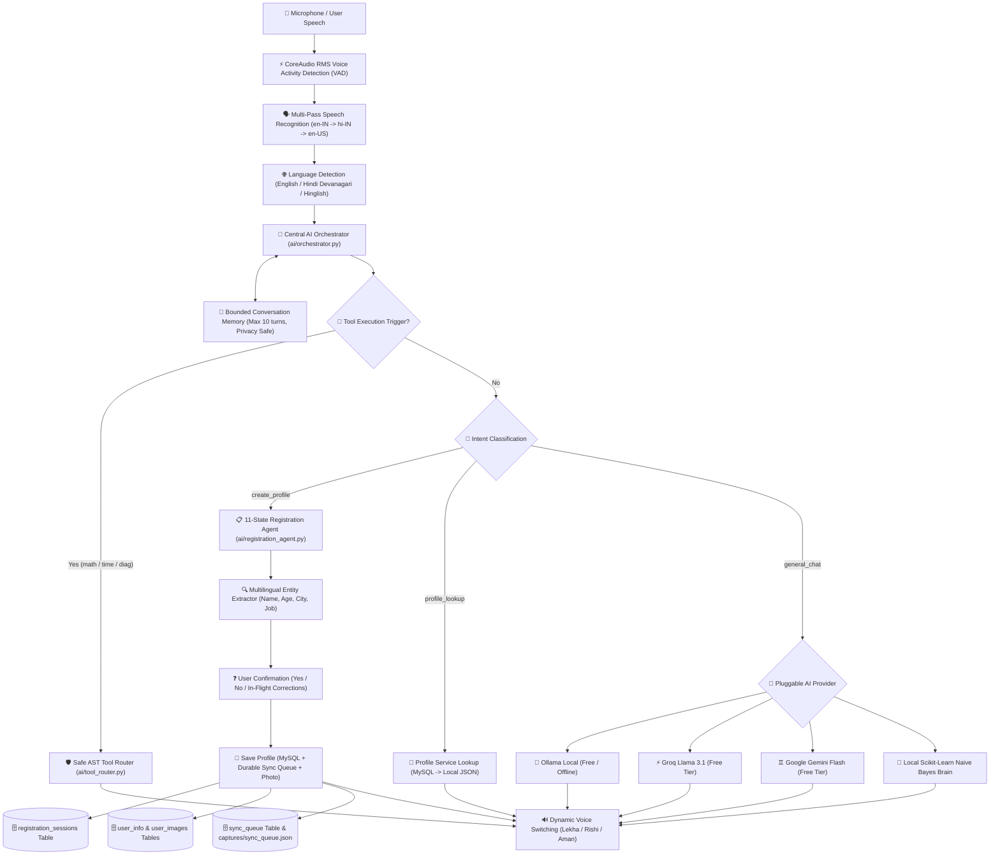

# 🤖 Mr. Beast — Advanced Multilingual AI Voice Robot & Autonomous Profile Management System

[](https://www.python.org/)
[](https://opencv.org/)
[](https://www.mysql.com/)
[](https://opensource.org/licenses/MIT)

An advanced, production-grade multimodal AI desktop robot combining **Real-Time Computer Vision**, **Hands-Free Speech Processing in English, Hindi & Hinglish**, **Deterministic 11-State Profile Registration**, **Pluggable Provider Architecture (Ollama, Groq, Gemini, OpenRouter)**, **Durable Offline-First MySQL Synchronization**, and **Safe Application Tool Routing**.

---

## 📑 Table of Contents

1. [System Architecture & Workflow Diagram](#-system-architecture--workflow-diagram)
2. [Core Functional Modules](#-core-functional-modules)
   - [1. Multilingual Voice Engine (English, Hindi, Hinglish)](#1-multilingual-voice-engine-english-hindi-hinglish)
   - [2. 11-State Autonomous Profile Registration Agent](#2-11-state-autonomous-profile-registration-agent)
   - [3. Pluggable API & Tool Integration Registry](#3-pluggable-api--tool-integration-registry)
   - [4. Multi-Tier Database & Durable Sync Queue](#4-multi-tier-database--durable-sync-queue)
   - [5. Safe Tool Router & Bounded Memory](#5-safe-tool-router--bounded-memory)
   - [6. Desktop UI with Live Badges & Camera](#6-desktop-ui-with-live-badges--camera)
   - [7. Master Admin Dashboard (Desktop & Web)](#7-master-admin-dashboard-desktop--web)
3. [Prerequisites & macOS Installation](#-prerequisites--macos-installation)
4. [Configuration & Free-Tier API Providers](#-configuration--free-tier-api-providers)
5. [Database Setup (MySQL & phpMyAdmin)](#-database-setup-mysql--phpmyadmin)
6. [Running the Application](#-running-the-application)
7. [Master Admin Dashboard Guide](#-master-admin-dashboard-guide)
8. [Automated Test Suite](#-automated-test-suite)
9. [Multilingual Voice Commands Cheat Sheet](#-multilingual-voice-commands-cheat-sheet)
10. [Troubleshooting Guide](#-troubleshooting-guide)

---

## 🏗 System Architecture & Workflow Diagram



---

## 🚀 Core Functional Modules

### 1. Multilingual Voice Engine (English, Hindi, Hinglish)

- **Automatic Language Detection (`voice/language_manager.py`):** Automatically categorizes user speech into English (`en`), Devanagari Hindi (`hi`), or Latin-script Hinglish (`hinglish`) using Unicode character distribution and curated lexicon scoring.
- **Multilingual Age Parser:** Recognizes spoken numbers in English (_"twenty five"_), Hindi words (_"pachees"_, _"chaubees"_), Devanagari numerals (_"पच्चीस"_), and numeric digits.
- **Apple Native TTS Voice Switching (`voice/tts.py`):** Dynamically selects native CoreAudio voices on macOS:
  - Hindi (`hi-IN`): Apple native voice `com.apple.voice.compact.hi-IN.Lekha`
  - Indian English / Hinglish (`en-IN`): `com.apple.voice.Aman` or `com.apple.voice.compact.en-IN.Rishi`
  - Fallback: Thread-safe native macOS `say` utility.
- **Hands-Free VAD (`voice/stt.py`):** SoundDevice RMS-based energy thresholding with CoreAudio fallback and multi-pass locale resolution (`en-IN` $\to$ `hi-IN` $\to$ `en-US`).

---

### 2. 11-State Autonomous Profile Registration Agent

Coordinates deterministic, turn-by-turn registration without hallucination or skipped steps (`ai/registration_agent.py`):

| #   | State                         | Description                                               | Spoken Prompt (Localized)                                           |
| --- | ----------------------------- | --------------------------------------------------------- | ------------------------------------------------------------------- |
| 1   | `IDLE`                        | Waiting for trigger phrase                                | _Listening for commands..._                                         |
| 2   | `COLLECTING_NAME`             | Extracts full name (1 to 4 words)                         | _"What is your full name?"_ / _"अपना पूरा नाम बताइए।"_              |
| 3   | `COLLECTING_AGE`              | Parses numeric, English, or Hindi age                     | _"What is your age?"_ / _"आपकी उम्र कितनी है?"_                     |
| 4   | `COLLECTING_CITY`             | Extracts city/location with prefixes stripped             | _"Which city or address do you live in?"_                           |
| 5   | `COLLECTING_PROFESSION`       | Extracts occupation, job, or college                      | _"What is your profession or occupation?"_                          |
| 6   | `COLLECTING_OPTIONAL_DETAILS` | Collects email and phone, or allows skip                  | _"Would you like to provide an email or phone, or skip?"_           |
| 7   | `AWAITING_CONFIRMATION`       | Summarizes all data and asks for Yes/No                   | _"You said your name is X, age Y, living in Z... Is this correct?"_ |
| 8   | `SAVING`                      | Snaps profile photo, inserts into MySQL and offline queue | _"Saving confirmed profile to database..."_                         |
| 9   | `COMPLETED`                   | Registration confirmed & completed                        | _"Congratulations! Your profile has been saved."_                   |
| 10  | `CANCELLED`                   | User requested stop or cancelled                          | _"Profile registration has been cancelled."_                        |
| 11  | `ERROR`                       | Handles unexpected failure and permits retry              | _"An error occurred. Would you like to retry or cancel?"_           |

#### Special Flow Capabilities:

- **In-Flight Corrections:** The user can correct any field at any time (e.g., _"Actually my age is 26"_, _"Change my name to Amit"_). The agent updates the specific field and resumes or re-confirms.
- **Skipping Optional Fields:** Say _"skip"_ or _"chhor do"_ on address, job, or optional fields. Name and Age are mandatory.
- **Cancellation:** Say _"cancel"_, _"stop"_, or _"rok do"_ at any point to gracefully abort the session.
- **Session Persistence:** Every state change is recorded in the MySQL `registration_sessions` table with a unique `session_id`.

---

### 3. Pluggable API & Tool Integration Registry

Located in `services/provider_registry.py`, providers are unified behind abstract interfaces with health checking:

1. **Local Brain Provider (Default & Free):** Built-in TF-IDF + Multinomial Naive Bayes classifier. Operates 100% offline with zero dependencies.
2. **Ollama Local API (Free & Private):**
   - Docs: [https://docs.ollama.com/api/introduction](https://docs.ollama.com/api/introduction)
   - Models: `llama3`, `mistral`, `gemma2`
3. **Groq Cloud API (Free Tier):**
   - Docs: [https://console.groq.com/docs/overview](https://console.groq.com/docs/overview)
   - Get Key: [https://console.groq.com/keys](https://console.groq.com/keys)
   - Model: `llama-3.1-8b-instant`
4. **Google Gemini API (Free Tier):**
   - Docs: [https://ai.google.dev/gemini-api/docs](https://ai.google.dev/gemini-api/docs)
   - Get Key: [https://aistudio.google.com/app/apikey](https://aistudio.google.com/app/apikey)
   - Model: `gemini-1.5-flash`
5. **OpenRouter API:**
   - Docs: [https://openrouter.ai/docs](https://openrouter.ai/docs)

---

### 4. Multi-Tier Database & Durable Sync Queue

The system implements a dual-store architecture: MySQL for production relational queries and a local JSON queue (`captures/sync_queue.json`) for zero data loss during network or database outages (`db/sync_manager.py`).

#### 6 MySQL Tables (`db/init_db.sql`):

1. `user_info`: Stores demographic records (`id`, `uuid`, `name`, `age_range`, `gender`, `college_or_job`, `address`, `email`, `phone`, `preferred_language`, `photo_path`, `consent`, `sync_status`).
2. `user_images`: Stores face embeddings and photo file paths (`image_id`, `user_id`, `file_path`, `embedding`, `is_primary`).
3. `conversation_log`: Multi-turn dialogue history (`log_id`, `user_id`, `speaker`, `message`, `language`, `intent`, `confidence`).
4. `user_behavior`: Interaction metrics for clustering (`conversation_length`, `speaking_speed`, `emotion_neutral_count`).
5. `registration_sessions`: State machine session tracking (`session_id`, `language`, `current_state`, `collected_data`, `status`).
6. `sync_queue`: Durable offline-to-online transaction sync records (`sync_id`, `uuid`, `entity_type`, `action`, `payload`, `status`).

---

### 5. Safe Tool Router & Bounded Memory

- **Safe Tool Router (`ai/tool_router.py`):**
  - Strictly disallows arbitrary shell commands or raw SQL injection.
  - Safe Math Evaluator using Python's `ast` parser (supports `+`, `-`, `*`, `/`, `**`).
  - Datetime tool (`get_datetime`).
  - Diagnostics tool (`run_diagnostics`) querying `HealthService`.
  - Confirmation-gated profile deletion (`delete_profile` requires explicit `confirmed=True`).
- **Bounded Conversation Memory (`ai/conversation_memory.py`):**
  - Keeps recent utterances (default 10 turns) in memory for LLM context without retaining unlimited raw audio or transcript files.

---

### 6. Desktop UI with Live Badges & Camera

Built using Python Tkinter (`ui/robot_ui.py`) with automatic fallback to CLI:

- **Title Bar Status Badges:**
  - `[ 🟢 DB: Connected (2ms) ]` or `[ 🟠 DB: Offline (JSON) ]`
  - `[ 🤖 AI: Ready (Groq/Ollama/Local) ]`
  - `[ 🔄 Sync: 0 Pending ]`
- **Language Selector Combobox:** Allows user to lock language to `Auto Detect`, `English (en)`, `Hindi (hi)`, or `Hinglish`.
- **Live User Profile Form Card:** Displays real-time updates as answers are extracted from speech, with:
  - `[ ✏ Edit Card ]`: Opens a modal dialog to manually inspect and edit fields.
  - `[ 🔄 Sync DB ]`: Manually flushes offline pending records to MySQL.
- **OpenCV 640x480 Live Canvas:** Shows bounding box, demographic predictions, and emotion estimates.
- **Header Toolbar Admin Button:** Direct `[ 🛡️ Admin ]` button launching the graphical administration console.

---

### 7. Master Admin Dashboard (Desktop & Web)

Provides unified system visibility and control across MySQL (`mr_beast_db`) and offline fallback stores:

- **Desktop Graphical Console (`ui/admin_dashboard.py`):**
  - **Header Telemetry Cards:** Total Users, Conversation Logs, Pending Sync Queue, and Live MySQL Latency.
  - **Tab 1 — 👥 User Profiles:** Search filter, sortable multi-column table (ID, Name, Age, Gender, Job, City, Email, Phone, Status), photo preview badge, and full CRUD modal actions (Add, Edit, Delete).
  - **Tab 2 — 💬 Conversation History:** Multi-speaker turn viewer with speaker filtering (`All`, `User`, `Robot`), detected language, extracted intent, and confidence score.
  - **Tab 3 — 📋 Registration Sessions:** Inspect live in-progress and completed sessions from `registration_sessions` with formatted JSON payload viewer.
  - **Tab 4 — 🔄 Sync Queue & Health Diagnostics:** Inspect durable offline items, trigger immediate sync to MySQL, and view live component diagnostics.
  - **JSON Data Export:** Single-click export of the entire database state into a portable JSON document.
- **Zero-Dependency Web Admin Dashboard (`services/web_admin.py`):**
  - Runs in any web browser at `http://localhost:8080`.
  - Built exclusively with Python's standard library `http.server` (zero external web dependencies).
  - REST API endpoints for user profiles, search, deletion, sync triggers, telemetry polling, and photo serving.

---

## 💻 Prerequisites & macOS Installation

### 1. System Requirements

- macOS (Apple Silicon M1/M2/M3/M4 or Intel)
- Python 3.12 (via Homebrew)
- MySQL / MariaDB (via Homebrew, XAMPP, or MAMP)
- Active Webcam & Microphone

### 2. Install System Dependencies via Homebrew

```bash
brew install python@3.12 python-tk@3.12 mysql
```

### 3. Setup Virtual Environment

```bash
# Clone and enter directory
cd /Users/ashishojha/Documents/python/face-voice-detection-using-the-python

# Create virtual environment with Homebrew Python 3.12
python3.12 -m venv venv

# Activate virtual environment
source venv/bin/activate

# Install Python requirements
pip install -r requirements.txt
```

---

## ⚙️ Configuration & Free-Tier API Providers

### 1. Copy Environment Template

```bash
cp .env.example .env
```

### 2. Configure Credentials in `.env`

```ini
# Primary Conversational AI Provider (local_brain | groq | gemini | ollama)
PRIMARY_AI_PROVIDER=local_brain

# Groq Cloud API (Free Tier: https://console.groq.com/keys)
GROQ_API_KEY=your_groq_api_key_here
GROQ_MODEL=llama-3.1-8b-instant

# Google Gemini API (Free Tier: https://aistudio.google.com/app/apikey)
GEMINI_API_KEY=your_gemini_api_key_here
GEMINI_MODEL=gemini-1.5-flash

# Local Ollama (Free Tier: http://localhost:11434)
OLLAMA_HOST=http://localhost:11434
OLLAMA_MODEL=llama3

# MySQL Credentials (Default: root with no password)
DB_HOST=localhost
DB_PORT=3306
DB_USER=root
DB_PASSWORD=
DB_NAME=mr_beast_db
```

---

## 🗄 Database Setup (MySQL & phpMyAdmin)

### 1. Start MySQL Server

```bash
# Start MySQL via Homebrew service
brew services start mysql

# Or if using XAMPP/MAMP: Start the MySQL service from the control panel
```

### 2. Initialize Database & Tables

Run the migration script to initialize all 6 tables:

```bash
mysql -u root < db/init_db.sql
```

### 3. Verify in phpMyAdmin

1. Open your browser: `http://localhost/phpmyadmin`
2. Select database `mr_beast_db`
3. Verify that all 6 tables are present:
   - `user_info`
   - `user_images`
   - `conversation_log`
   - `user_behavior`
   - `registration_sessions`
   - `sync_queue`

---

## 🚀 Running the Application

### 1. Desktop UI Mode (Standard)

Auto-launches camera feed, face detection, status badges, voice listener, and top Admin button:

```bash
./venv/bin/python main.py
```

### 2. Standalone Desktop Admin Dashboard (Tkinter)

Launch the dedicated graphical management console:

```bash
./venv/bin/python main.py --admin
# Or using shortcut flag:
./venv/bin/python main.py -a
```

### 3. In-Browser Web Admin Dashboard (Port 8080)

Launch the zero-dependency web dashboard and open it in your default browser:

```bash
./venv/bin/python main.py --web-admin
# Or using shortcut flag:
./venv/bin/python main.py -w
```

Open **`http://localhost:8080`** in any web browser.

### 4. Command-Line (CLI) Camera Mode

Runs vision and conversation in an OpenCV window without Tkinter:

```bash
./venv/bin/python main.py --cli
```

### 5. Voice-Only Terminal Mode

Runs hands-free voice dialogue without camera overhead:

```bash
./venv/bin/python main.py --voice
```

### 6. Hardware Diagnostic Checks

```bash
# Test CoreAudio microphone input
./venv/bin/python main.py --test-mic

# Test pyttsx3 speech synthesizer
./venv/bin/python main.py --test-tts

# Test MySQL database connection
./venv/bin/python main.py --test-db

# Flush offline durable sync queue to MySQL
./venv/bin/python main.py --sync
```

---

## 🛡️ Master Admin Dashboard Guide

The Admin Dashboard provides full visibility and operational control across the entire Mr. Beast ecosystem:

### 1. Feature Matrix

| Feature               | Desktop Tkinter (`--admin`)                      | Web Browser (`--web-admin`)                           |
| :-------------------- | :----------------------------------------------- | :---------------------------------------------------- |
| **Telemetry Badges**  | Users, Convos, Sync Queue, DB Latency            | Users, Convos, Sync Queue, DB Latency, AI Engine      |
| **User Profiles**     | Multi-column table, search filter, photo preview | Multi-column table, real-time search, photo avatars   |
| **User CRUD**         | Add, Edit, Delete modals                         | Add, Edit, Delete modals with real-time UI updates    |
| **Conversation Logs** | Filter by speaker (All, User, Robot)             | Filter by speaker (All, User, Robot) with intent tags |
| **Session Tracking**  | Inspect live state machine turns & JSON payload  | Inspect live state machine turns & JSON modal viewer  |
| **Sync Management**   | Inspect queue, trigger sync to MySQL             | Inspect queue, trigger sync to MySQL                  |
| **Diagnostics**       | Real-time provider health report                 | Real-time provider health report                      |
| **JSON Export**       | Save file dialog                                 | One-click download `/api/export`                      |

### 2. Zero-Dependency REST API Endpoints

The web server (`services/web_admin.py`) exposes standard REST APIs over HTTP port 8080:

- `GET /api/stats`: Telemetry metrics, connection status, latency, and counts.
- `GET /api/users?q={search}`: User profile search and listing.
- `POST /api/users`: Create or update user profile.
- `POST /api/users/delete` or `DELETE /api/users/{id}`: Delete user profile.
- `GET /api/conversations?speaker={speaker}`: Historical conversation turns.
- `GET /api/sessions`: Stateful multi-turn registration sessions.
- `GET /api/sync-queue`: Durable offline queue items awaiting MySQL flush.
- `POST /api/sync/trigger`: Trigger immediate bidirectional sync to MySQL.
- `GET /api/diagnostics`: Live hardware and AI component health.
- `GET /api/export`: Full system database export as JSON.
- `GET /captures/{filename}`: Safe static profile photo delivery.

---

## 🧪 Automated Test Suite

The project includes an end-to-end automated test suite covering all modules:

```bash
./venv/bin/python main.py --test-all
```

### Test Coverage Summary (35 Tests Passing in ~3.2s):

- `tests/test_admin_service.py`: Multi-store data aggregation, search filtering, user CRUD, export, and telemetry.
- `tests/test_entity_extractor.py`: Multilingual name, age, city, job, email, and phone parsing.
- `tests/test_multilingual_voice.py`: Language detection (`en`, `hi`, `hinglish`), age words, and Apple TTS voices (`Lekha`, `Rishi`, `Aman`).
- `tests/test_registration_agent.py`: 11-state machine, in-flight field corrections, optional fields, skipping, and cancellations.
- `tests/test_orchestrator.py`: Architectural branching (`create_profile`, `profile_lookup`, `general_conversation`, `tool_execution`).
- `tests/test_sync_manager.py`: Durable local queue (`sync_queue.json`), idempotent deduplication, and sync status.
- `tests/test_tool_router.py`: AST math evaluation safety, datetime, diagnostics, and confirmation gates.
- `tests/test_provider_registry.py`: Abstract provider health checks and fallback mechanics.
- `tests/test_profile_service.py`: CRUD operations, UUID generation, local JSON + MySQL dual-store persistence.

---

## 🗣 Multilingual Voice Commands Cheat Sheet

| Intent                 | Spoken Utterance (English)                          | Spoken Utterance (Hindi / Hinglish)              | Robot Action                                        |
| ---------------------- | --------------------------------------------------- | ------------------------------------------------ | --------------------------------------------------- |
| **Create Profile**     | _"I want to create my profile"_ / _"Register me"_   | _"Mera profile bana do"_ / _"नया प्रोफाइल बनाओ"_ | Initiates 11-step registration state machine.       |
| **Correction**         | _"Actually my age is 28"_ / _"Change name to Amit"_ | _"Meri umar badal kar 26 kar do"_                | Updates target field in-flight without resetting.   |
| **Skip Field**         | _"Skip this field"_                                 | _"Isko chhor do"_ / _"Skip karo"_                | Skips current optional field (Address, Job, Email). |
| **Cancel**             | _"Cancel registration"_ / _"Stop"_                  | _"Rok do"_ / _"Registration cancel karo"_        | Gracefully aborts registration state machine.       |
| **Confirmation**       | _"Yes, correct, save it"_                           | _"Haan bilkul sahi hai save kar do"_             | Takes camera snapshot and commits to MySQL.         |
| **Profile Lookup**     | _"Who am I?"_ / _"Check my profile"_                | _"Mera profile dikhao"_ / _"Main kaun hoon?"_    | Searches MySQL and local store for user record.     |
| **Safe Math**          | _"Calculate 25 _ 4 + 10"\*                          | _"Hisab karo 50 divided by 2"_                   | Evaluates mathematical expression via AST.          |
| **Live Time & Date**   | _"What time is it?"_ / _"What is the date?"_        | _"Time kya hai?"_ / _"Aaj konsa din hai?"_       | Reports formatted live system datetime.             |
| **System Diagnostics** | _"Run diagnostics"_ / _"Check system health"_       | _"System check karo"_                            | Inspects DB, AI providers, STT, and sync queue.     |
| **Greeting**           | _"Hello Mr. Beast"_                                 | _"Namaste Mr. Beast"_                            | Greets user in matching detected language.          |

---

## 🛠 Troubleshooting Guide

### 1. `ModuleNotFoundError: No module named '_tkinter'`

- **Cause:** Homebrew Python on macOS requires the separate Tk bindings formula.
- **Fix:**
  ```bash
  brew install python-tk@3.12
  ```
  _(The application will automatically fallback to OpenCV CLI mode if Tkinter is not installed)._

### 2. Microphone Fails or No Audio Input

- **Cause:** macOS Terminal / IDE lacks microphone permissions, or wrong input device selected.
- **Fix:**
  1. Open **System Settings $\to$ Privacy & Security $\to$ Microphone**.
  2. Enable permission for **Terminal**, **iTerm2**, or **VS Code / Cursor**.
  3. Verify input device: `./venv/bin/python main.py --test-mic`.

### 3. MySQL `Can't connect to MySQL server on 'localhost:3306'`

- **Cause:** MySQL service is not running.
- **Resilience Behavior:** Mr. Beast's **offline resilience layer** automatically activates: profiles are safely persisted into `captures/profiles.json` and queued in `captures/sync_queue.json`.
- **To Start MySQL:**
  ```bash
  brew services start mysql
  # Then click [🔄 Sync DB] in the desktop UI or run python main.py
  ```

### 4. `AttributeError: module 'cv2' has no attribute 'CascadeClassifier'`

- **Cause:** An unpinned `opencv-python` preview build was installed.
- **Fix:** Keep OpenCV pinned to stable 4.x:
  ```bash
  pip install "opencv-python<5" "opencv-contrib-python<5"
  ```

---

## 📜 Architecture & License

- Designed and architected as an autonomous multimodal desktop assistant.
- Open-source under the [MIT License](LICENSE).
